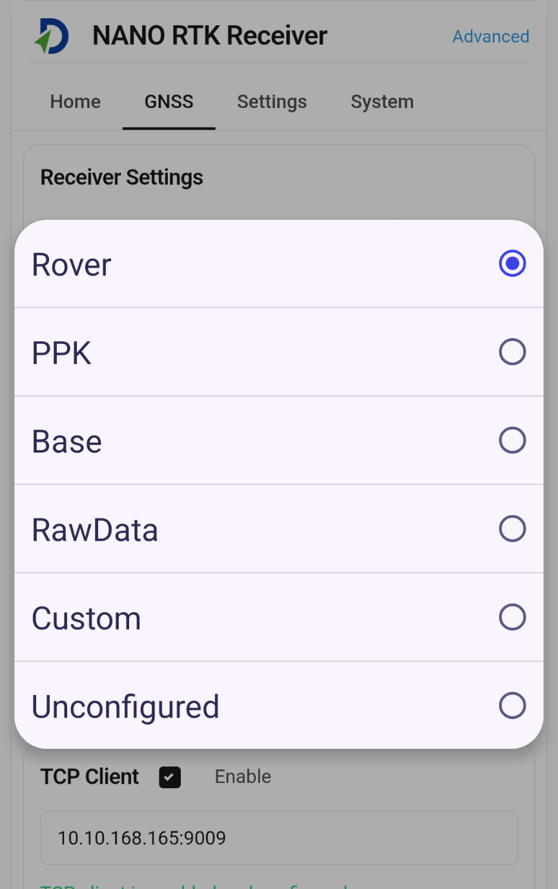
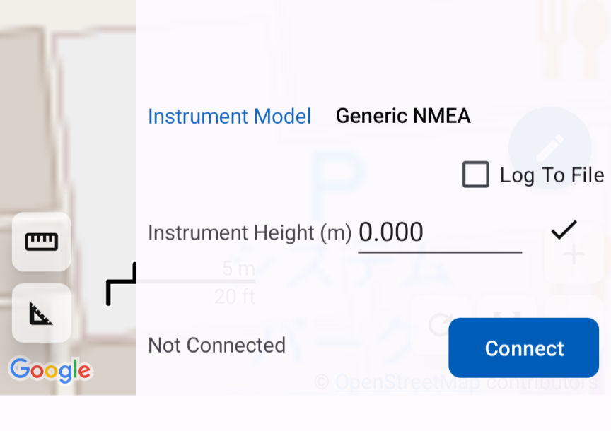
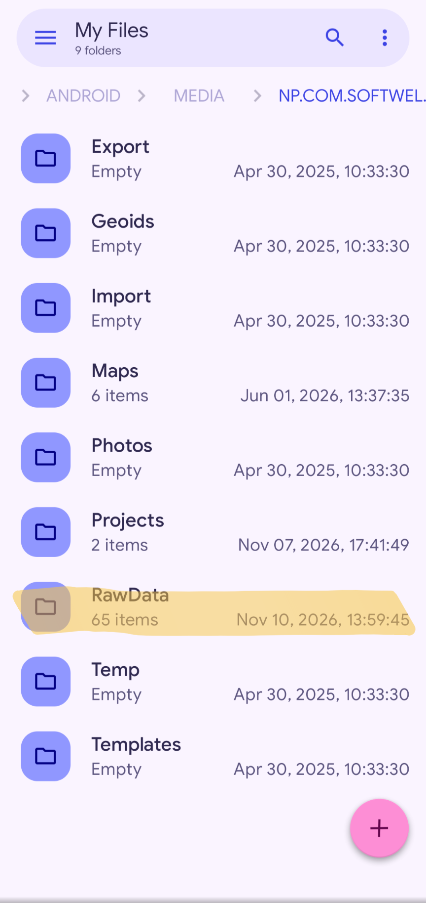
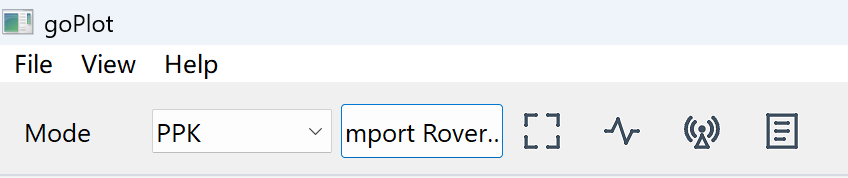
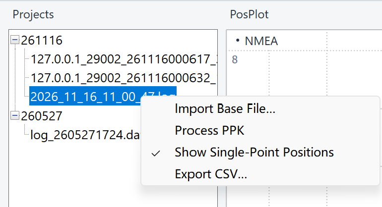
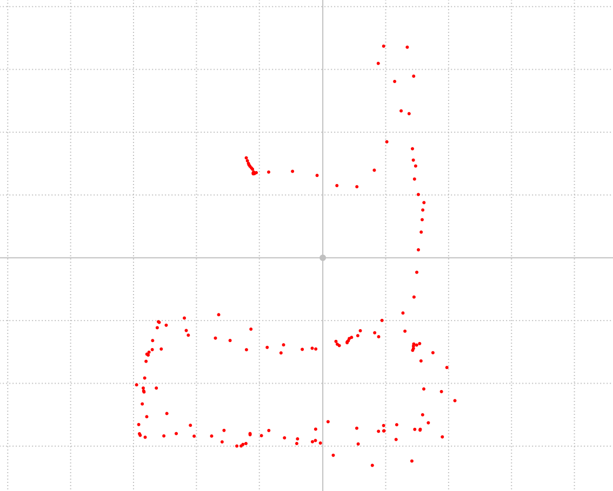
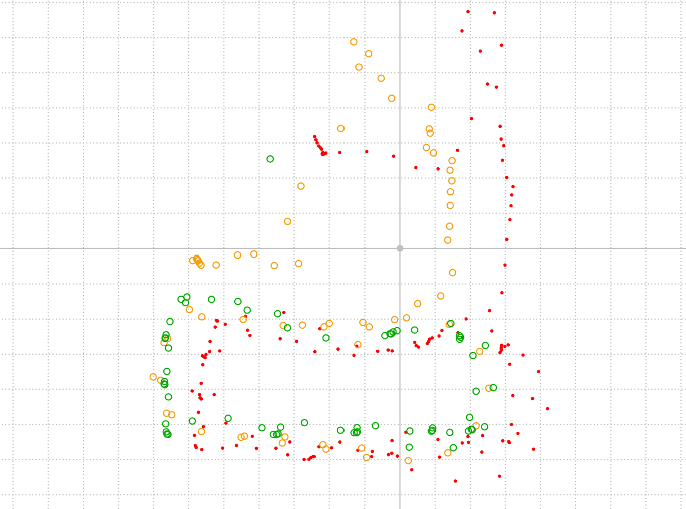

# PPK with the NANO RTK Receiver Pro

Post-Processed Kinematic (PPK) positioning combines raw GNSS observations from the rover with observations recorded at a reference station during the same time period.

## Why use PPK?

In the field, you may be unable to receive real-time RTK corrections from a base station, for example in areas with poor mobile coverage. With PPK, you can record raw GNSS data with the rover during the survey. Back at the office, download the reference station's RINEX observations for the same time period and process them together with the rover recording.

## What you need

- NANO RTK Receiver Pro
- AT400 antenna or a helix antenna for RTK
- Android phone with [SW Maps](https://aviyaantech.com/SwMaps/index.html), the recommended app for recording
- RINEX observation data from a nearby public GNSS reference station, such as a Continuously Operating Reference Station (CORS). Download files that cover the full rover recording session.

## 1. Set the receiver to PPK mode

Connect the antenna and open the receiver's web configuration page. Select **PPK** mode and apply the setting. In this mode, the receiver outputs both NMEA messages and raw GNSS data.

## 2. Record the rover data in SW Maps

1. Open SW Maps on Android and go to the GNSS receiver connection screen.
2. Select your NANO RTK Receiver Pro and enable **Log to File**.
3. Tap **Connect** and collect your field data with the receiver connected.
4. Disconnect the receiver in SW Maps when you finish collecting data.

## 3. Retrieve the recording on Android

On Android 11 and later, open your file manager and go to `Android/media/np.com.softwel.swmaps` in internal storage. Look for the recording in the `RawData` folder under the SW Maps root folder. You can check the active root folder in SW Maps under **Settings**. [SW Maps User Manual](https://aviyaantech.com/SwMaps/assets/SW%20Maps%20Manual%20V3.0.pdf)

## 4. Run PPK processing in goPPK

Copy the rover recording to your computer and have the reference station's RINEX observations for the same time period ready. [Download goPPK for Windows (64-bit)](https://docs.datagnss.com/software/goPPK/goPlot-latest-windows-amd64.zip), extract the ZIP, and open goPPK.

1. Set **Mode** to **PPK** and import the rover file you recorded in SW Maps.

   

2. Find the imported rover file in the project list on the left. Right-click it, choose **Import Base File...**, and select the reference station's RINEX observation file.

   

3. Right-click the rover file in the project list and choose **Process PPK** to start processing.

   

     <figure style="margin: 0;">
       
       <figcaption>Single-point positioning</figcaption>
     </figure>
     <figure style="margin: 0;">
       
       <figcaption>After PPK processing</figcaption>
     </figure>
   

## PPK baseline distance

For the current version of goPPK, we recommend choosing a base station within **20 km** of the rover. Long-baseline PPK is not currently supported. We plan to extend support to baselines of up to **50 km** in a future software update.
