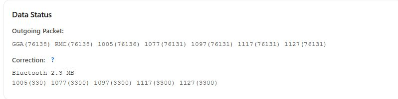
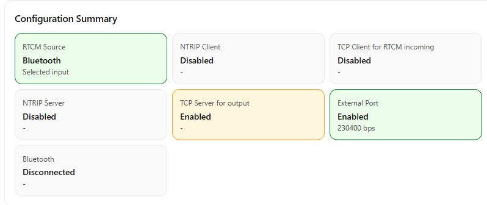

# NANO RTK Receiver Pro User Manual

> **Review draft.** The Web UI examples were observed read-only on 2026-11-20 on NANO application firmware `1.0.8.1496.ff5ccc` (GNSS module `D10PA.1207dccc7`). The hardware revision was not separately verified. Observed: the Web UI displayed Rover / 1 Hz / Bluetooth as its current selection. Visible options are not test results. Not tested: switching modes, measuring output rates, transferring corrections over each source, or updating firmware. If this manual differs from the verified behavior of your own build, use that verified behavior.

This guide covers initial setup, RTK corrections and field checks. Menu labels vary with hardware and firmware. Before changing settings or upgrading, identify the [hardware revision and installed firmware](/gnss/rtk_receiver/NANO/find-v32-and-v35/). A NANO application firmware version is not the GNSS module firmware version.

### Before you begin

Have the receiver, a compatible GNSS antenna, a stable USB power source and a phone or computer ready. For RTK, obtain access to a compatible correction stream. For a survey, also obtain the project's coordinate and height reference and a known point for checking the result.

Record the application firmware and GNSS firmware separately. **System Information** on the inspected build contains Model, Firmware and GNSS Version fields. Its model name alone was not enough to establish the inspected unit's PCB revision; confirm the board revision before using a wiring diagram or choosing firmware.

Instructions below describe workflows to check on your build. Only the observations explicitly identified as checked were verified on the review unit. BLE/USB data transfer, new Wi-Fi connections, RTK operation, PPK recording and firmware installation remain untested on that unit.

## 1. Connect and power the receiver

Attach a compatible GNSS antenna and place it where it has a clear view of the sky. Use a stable power source and a cable suitable for your receiver and host. A charge-only USB cable will not carry data. Confirm the pinout and supply limits for your exact board before connecting external power or accessories; do not wire a connector by shape alone.

- **Bluetooth Low Energy (BLE):** Connect from the GNSS app rather than assuming that a paired device is already streaming. In SW Maps, open the GNSS connection controls, select the external receiver and verify that fresh GNSS data appears. For SW Maps on iPhone or iPad, use BLE.
- **USB:** Connect a supported Android device or a computer with a USB data cable. Android may need a compatible OTG connection. On a computer, confirm that the serial device appears, then open it with a compatible tool at the receiver's configured rate.
- **Wi-Fi:** Use the receiver's setup hotspot (AP) to reach its local configuration page. To operate the receiver as a client on another Wi-Fi network (STA), use the receiver's network settings, then look up the IP address assigned by that network under System Information. A local configuration page does not require internet; a remote NTRIP caster generally does.

### Find your way around the Web UI

Open the receiver's local address in a browser on the same network. Use the address supplied for your own unit or shown by its network, rather than an address copied from a screenshot. The inspected build provides these pages:

| Page | What to inspect |
| --- | --- |
| Home | GNSS status, Outgoing Packet counters, Correction and Configuration Summary. |
| GNSS | Receiver mode, output rate, message controls and correction-source controls. |
| Settings | Wi-Fi, External Port and TCP Server controls. |
| System | Model, application firmware and GNSS version. Keep device and network identifiers private. |
| Firmware Update | Firmware file-selection and update controls. Opening this page does not perform an update. |

When checking an existing setup, read its status first. Saving network settings can change the address or disconnect the browser. Record the intended connection method before making a planned change.

## 2. Choose a role

| Role | Use it for |
| --- | --- |
| Rover | Receive corrections and calculate real-time positions. |
| Base | Send observations and a reference position so a rover can calculate positions relative to the base. |
| Raw observations | Collect observations for an offline workflow. Confirm available formats and messages for your hardware and firmware before starting the survey. |

On the observed build, the GNSS mode menu offered **Rover**, **PPK**, **Base**, **RawData**, **Custom** and **Unconfigured**. The rate menu listed **1, 5 and 10 Hz**; the device was observed in **Rover / 1 Hz**. Do not assume all rates are available in every mode, or that the chosen rate is the measured rate of each message. Use Unconfigured only when another tool will manage the GNSS module.

The GNSS page also contains NMEA and RTCM message controls. The presence of a checkbox does not establish that a message is being output. Preserve the messages required by your app and verify a captured stream after any planned change. **PPK**, **RawData** and **Custom** are separate menu entries; their output contents and preset behavior were not tested, so this draft does not treat them as interchangeable recording modes.

## 3. Set up a rover with an NTRIP service

1. Configure the NANO as a rover.
2. Choose **one** path for the corrections: the app fetches corrections and sends them to the receiver over a supported connection, or the NANO connects to the caster directly over Wi-Fi.
   The observed Web UI listed **Bluetooth**, **External Port**, **NTRIP Client** and **TCP Client** for the correction source. The Home page distinguishes incoming RTCM on the TCP client from outgoing data on the TCP server. Choose a correction source supported by your workflow and firmware.
3. Enter the caster host, port, mountpoint and login details on the device or app that will connect. If the service requires a rover position, enable its supported GGA feedback option.
4. Verify the rover receives data and reports RTK Float or RTK Fixed. An enabled connection is not necessarily a working correction stream.

For step-by-step setup, see the [NANO quick guide](/gnss/rtk_receiver/NANO/nano-rtk-receiver-pro-guide/). Consult your app and correction provider for current menus and service-specific requirements.

### Keep the correction path clear

| Path | Intended data flow | Evidence to check |
| --- | --- | --- |
| App over BLE or USB | Caster → phone/computer app → receiver | The app receives corrections and forwards them through the active receiver connection. |
| Device NTRIP Client | Caster → receiver over Wi-Fi | The receiver has network access, receives fresh correction data and uses a compatible stream. |
| TCP Client | Configured TCP source → receiver | The endpoint sends the expected correction stream; a TCP connection alone is insufficient. |
| External Port | Compatible external source → receiver UART | Correct connector, electrical levels, direction, baud rate and fresh correction input. |

USB correction input is described in the product documentation, but **USB** was not a separate entry in the inspected correction-source menu. Confirm the required setting for your build before relying on that path. The Settings page exposes RX/TX swapping, GNSS forwarding and baud-rate controls for the external port; do not use these controls as a substitute for verifying its wiring and electrical limits.

The served GNSS page contains NTRIP v1/v2, server, port, mountpoint, username, password and Send GGA controls. Their visibility in the browser can depend on the selected source; this review did not change the source to reveal or apply them. It did not establish login success, supported authentication behavior or GGA transmission. Follow the provider's protocol and GGA requirements rather than assuming a universal default.

**TCP Server** is an output service in the Home summary and is distinct from **TCP Client** correction input. Likewise, an NTRIP Client receives from a caster, while a base-side NTRIP Server sends a stream to a caster. Check the direction before configuring an endpoint.

## 4. Use your own base and rover

Install the base antenna on a stable mount, record the antenna reference-point height and use a verified base coordinate if the survey needs to match an existing reference frame. Where the receiver supports survey-in, it estimates a position from its observations; a longer survey-in does not by itself guarantee agreement with a surveyed coordinate. A base-coordinate error can shift all rover points even when the receiver reports RTK Fixed.

Configure the base in base mode and the field receiver in rover mode. With an internet-based setup, the base sends correction data to a caster, which makes that stream available to the rover. A caster distributes the stream; the rover calculates its position. For a local caster or a compatible radio, verify the link and available messages with the equipment documentation rather than assuming that a position seen on the web page confirms transmission.

Follow the [own-base setup guide](/gnss/rtk_receiver/casestudy/setup-owned-base-and-rover/) and [verify the base correction stream](/common/common_how_to_verify_base_station/). A network of continuously operating reference stations (CORS) may instead provide a correction stream, if it serves your site and receiver configuration. Confirm the mountpoint and coordinate reference with the operator.

The inspected GNSS page contains **Survey-In** and **Fixed Lat/Lon/H** controls. Its Survey-In fields are labelled **Minimum Duration (s)** and **Accuracy Limit (mm)**. These labels establish the displayed units only. The fixed-coordinate height reference, accepted coordinate format, survey completion criteria and emitted correction messages still require validation before this draft can provide a tested base-configuration procedure. Do not enter a project elevation into an unverified height field.

## 5. Verify data before collecting points

The Home page separates Outgoing Packet counters from the Correction display. The two panels below show one observed setup, not factory defaults or an RTK acceptance test. A selected correction source can remain selected after its sender disconnects, and accumulated counters do not prove that fresh corrections are arriving now. In a second read-only observation, the displayed UTC advanced and the outgoing GGA counter increased by four without a page reload. This confirms that the Home display refreshed during the observation, not that any correction source, rate or mode was tested.

A later read-only check of the same build's status interface, with two samples about five seconds apart, found that UTC advanced and the GGA counter increased by five. The reported output-rate setting remained 1 Hz. This is a short observation of changing counters, not a sustained measurement of output cadence or delivery to a connected app.

- On the NANO status page, look for current timestamps and position data, then check the selected correction source and whether input is actually arriving. If firmware shows a correction age, check it for staleness.
- **Single** is a standalone position; **Float** indicates the RTK ambiguity solution is not fixed; **Fixed** indicates ambiguity resolution. These labels are not independent proof of absolute accuracy.
- Occupy a known point in open sky. Compare receiver and project coordinates in the same reference frame and epoch, and compare like heights. Verify antenna height and any transformation applied by the app before relying on exported coordinates.
- In SW Maps for Android, [create a GNSS Recorded Feature layer with Point geometry](https://aviyaantech.com/SwMaps/assets/SW%20Maps%20Manual%20V3.0.pdf#page=32), then use [Record Feature](https://aviyaantech.com/SwMaps/assets/SW%20Maps%20Manual%20V3.0.pdf#page=42) to save a measured point. To navigate to a point already in the map, open its properties and select [Feature Stakeout](https://aviyaantech.com/SwMaps/assets/SW%20Maps%20Manual%20V3.0.pdf#page=66). App interfaces may differ by version and platform.

Before saving a point, confirm the external receiver is the app's active source, the displayed time is fresh, the correction stream is current and the solution state is suitable for the job. Keep the antenna stable and record its height and measurement reference. Save the solution state with the measurement where the app supports it, then check a known point before proceeding.

The inspected Home page's satellite-chart help describes a three-second refresh from a complete GSV round. The chart's refresh interval is separate from the selected GNSS output rate. Do not measure the receiver's output frequency by watching chart updates. The help also describes Age as base-to-rover transmission latency, but its calculation and stale-data behavior were not verified; use it alongside input activity and solution state.

## 6. Raw observations and PPK

Record the full rover session and retain the original file. Obtain a base observation file that covers the same time period and verify the format, signals and antenna metadata before processing. Do not assume a position-only NMEA stream is a raw observation log. See the [PPK workflow guide](/common/common_ppk_guide/) for the current input and conversion workflow.

Before a production session, make a short test recording using the intended connection and logging app. Close the recording cleanly, copy it to the processing computer, and confirm the converter can read actual observations and their time span. Check that base and rover data overlap, then process a known-point test. Keep the receiver logs, base data, processing settings and result together. This recording and processing check has not been performed on the review unit; the PPK menu entry alone does not validate it.

## 7. Update firmware

Read the hardware revision and current firmware from the device and save a copy of your settings before an update. Use only the approved firmware and procedure for that revision. The web update and USB flasher are different methods, and a flasher for V3.5 is not a V3.2 upgrade path. Do not treat an upload error as success. Confirm the reported build after reboot and test the correction path and RTK status before returning the receiver to field use.

The inspected **Firmware Update** page advertises `*.dgfm` and `*.dgfw` in its file-selection label. No file was selected or uploaded. Those extensions do not establish that a package matches your hardware or that this build can install it. Consult the [firmware download guide](/gnss/rtk_receiver/NANO/nano-rtk-flash-download/) for the approved path after identifying the board. A progress bar reaching 100% is insufficient on its own: reconnect, read the installed version and verify normal operation. Recovery and rollback were not tested in this review.

## 8. Troubleshooting

| Symptom | Check first |
| --- | --- |
| The app cannot see the receiver | Power, compatible cable or BLE permissions, and whether another app or device has the connection. |
| The web page cannot be reached | Whether the host is on the receiver's hotspot or the same network as the receiver, and which IP address to use for that mode. |
| The receiver stays in Single or Float | Correct role, fresh correction stream, caster login and mountpoint, sky view and antenna setup. |
| The rover says Fixed but points are shifted | Base coordinate and antenna height, reference frame/epoch, coordinate conversion and export settings. |
| Firmware update fails | Verify exact hardware, package and update path; check the reported build and get the approved recovery instructions before retrying. |

### Information to collect for support

Record the model, confirmed hardware revision if available, both firmware versions, app/platform/version, connection method and test time with time zone. Describe the selected correction path, whether its input changes during the test, and the solution state when the problem occurs. For an offset, include the reference system, height convention, antenna setup and comparison method.

Where your tools support it, retain a short rover NMEA log and a separately labelled incoming correction capture from the same period. NMEA position output does not show which incoming RTCM messages were received or accepted. Share logs through an appropriate support channel; remove precise coordinates, credentials, device identifiers and private network details from material intended for publication.
